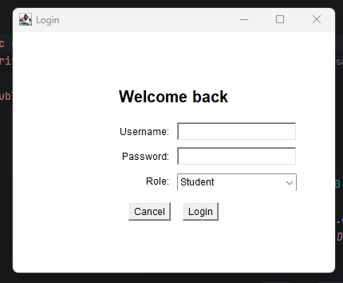
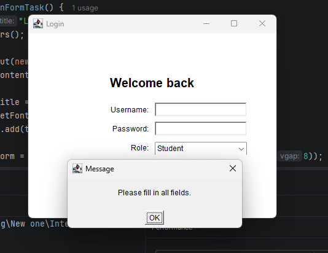
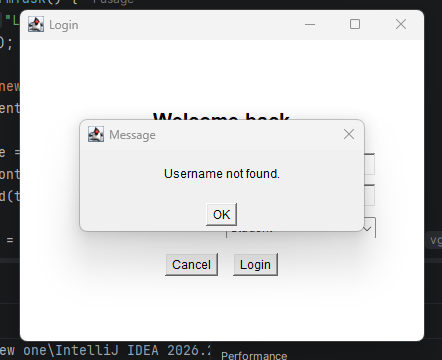
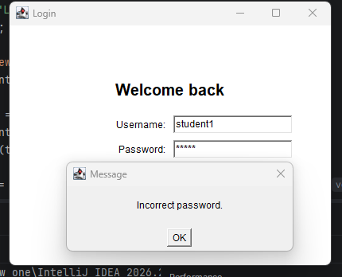
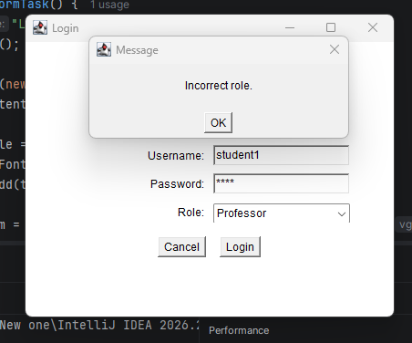
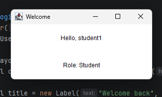

# Login Form (Java AWT)

A simple login form built with Java AWT. When the user presses **Login**, the program validates the input step by step and shows a short message dialog if something is wrong. On success it opens a welcome page.

## Files

| File | Description |
|------|-------------|
| `LoginFormTask.java` | Full source code (`User`, `WelcomePage`, `LoginFormTask`) |
| `screenshots/` | Screenshots of every case below |

## How to run

```bash
javac LoginFormTask.java
java LoginFormTask
```

> The file must be named `LoginFormTask.java` because the public class has the same name.

## Hard-coded users

The users are loaded in the `loadUsers()` method:

| Username | Password | Role |
|----------|----------|------|
| `student1` | `1234` | Student |
| `ta1` | `abcd` | TA |
| `prof1` | `admin123` | Professor |

- The username is **not** case-sensitive (`Student1` works).
- The password is **case-sensitive**.

## Validation order

1. Username and password are not empty
2. Username exists
3. Password is correct
4. Selected role matches the user's role
5. All good → open the Welcome page

## Cases

### 1. Initial form
The login window with Username, Password, Role (Student / TA / Professor), and the Cancel and Login buttons.



### 2. Empty fields
**Input:** username and/or password left empty, then Login.
**Result:** message `Please fill in all fields.`



### 3. Username not found
**Input:** a username that is not in the list, then Login.
**Result:** message `Username not found.`



### 4. Incorrect password
**Input:** `student1` with a wrong password.
**Result:** message `Incorrect password.`



### 5. Incorrect role
**Input:** `student1` with the correct password `1234`, but Role = `Professor`.
**Result:** message `Incorrect role.`



### 6. Successful login
**Input:** `student1` / `1234` / `Student`.
**Result:** the login window closes and the Welcome page opens showing `Hello, student1` and `Role: Student`.



## Other behavior

- **Cancel** button and the window close button (X) close the window.
- Messages are shown in a modal dialog with an **OK** button.
